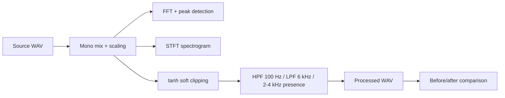
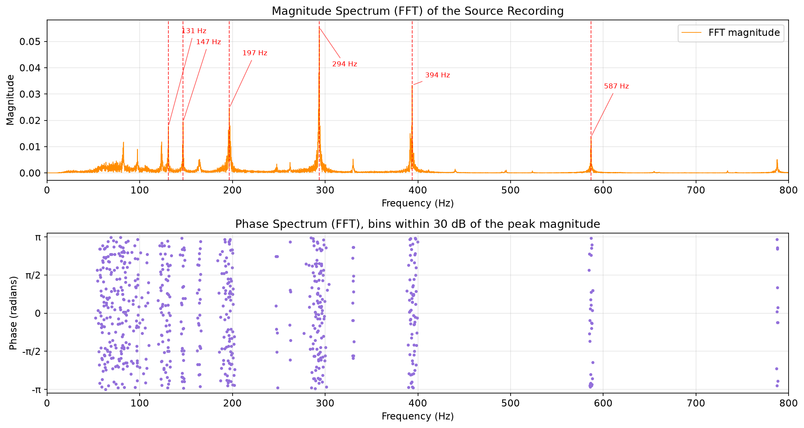
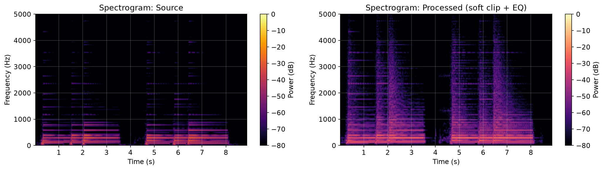
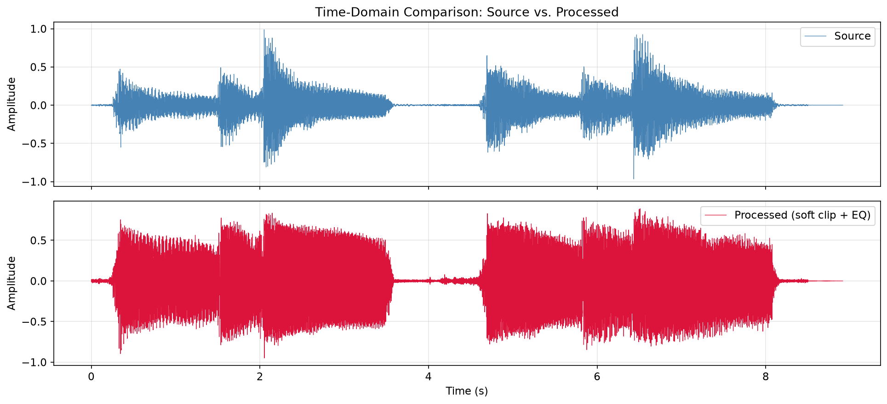

# Guitar Audio DSP

A Python signal-processing pipeline that analyzes a real acoustic-electric guitar recording and reshapes it toward a driven, electric-style tone. The recording is examined with FFT and STFT analysis, processed with tanh soft clipping and Butterworth EQ, and compared before and after in the time, frequency, and time-frequency domains.

This started as my final project for EECE 3210 (Signals & Systems) in Spring 2026 and was later cleaned up into this standalone repository.

## Overview

I chose an acoustic-electric guitar when I started learning because I wanted one instrument that could cover both a natural acoustic sound and a driven electric one. This project explores that idea in software. The input is a short clip of me strumming G major and Cadd9, recorded directly into GarageBand. The pipeline:

- analyzes the source recording in the time domain
- inspects its spectral content and identifies the dominant chord tones
- applies a nonlinear saturation stage to add harmonic content
- reshapes the frequency response with frequency-selective EQ
- compares the original and processed signals

## Processing Pipeline



## Signal Analysis

- **Waveform.** The stereo recording is averaged to mono and scaled to [-1, 1]; the time-domain plot shows the strum onsets and decay.
- **FFT.** `scipy.fft.rfft` gives the one-sided spectrum of the whole clip. Amplitudes are doubled for every bin except DC and Nyquist. Phase is plotted only for bins within 30 dB of the peak magnitude, since the phase of near-zero bins is meaningless.
- **Peak detection.** `scipy.signal.find_peaks` picks the strongest components below 800 Hz. The two largest are at 293.6 Hz and 393.8 Hz, close to D4 and G4, which are the two notes shared by both chords. Other peaks line up with the remaining chord tones (about 131 Hz near C3, 197 Hz near G3) and harmonics (587 Hz, the second harmonic of D4).
- **Spectrogram.** An STFT with a 2048-sample Hann window and 75% overlap shows how the harmonic content evolves over each strum.

## Audio Processing

1. **tanh soft clipping**, `y = tanh(8x) / tanh(8)`. Large samples are compressed smoothly, which adds harmonics and intermodulation products the source did not contain. This approximates an overdrive-style nonlinearity; it does not physically model a tube amplifier.
2. **Butterworth high-pass at 100 Hz** (4th order) to reduce low-frequency body resonance.
3. **Butterworth low-pass at 6 kHz** (4th order) to roll off high-frequency acoustic "air".
4. **Presence reinforcement at 2-4 kHz.** A 2nd-order band-passed copy of the signal is added back, roughly doubling the in-band amplitude (about +6 dB) near the band center.
5. Peak normalization and a 0.95 headroom gain before export to 16-bit PCM.

Every filter stage is applied with `scipy.signal.filtfilt`, which runs the filter forward and backward for zero phase distortion. That requires the entire signal up front, so this is an offline DSP experiment, not a real-time guitar-effects processor.

## Results

Listen to the [source recording](audio/source_guitar.wav) and the [processed result](audio/processed_guitar.wav). GitHub shows a download link for WAV files.

**Magnitude and phase spectrum of the source**, with detected peaks:



**Spectrogram before and after processing.** The dense energy from roughly 1 kHz up to the 6 kHz cutoff in the processed signal comes from the tanh nonlinearity. Linear filters can only rescale frequency components that already exist.



**Waveform before and after.** Soft clipping compresses the strum transients, giving a flatter, more sustained envelope.



Also generated: [waveform](results/waveform.png), [spectrogram](results/spectrogram.png), and [spectrum comparison](results/spectrum_comparison.png).

## Run Locally

```bash
python3 -m venv .venv
source .venv/bin/activate
pip install -r requirements.txt
python signal_processing.py
```

This reads `audio/source_guitar.wav` and writes `audio/processed_guitar.wav` and the plots in `results/`. To process a different WAV file:

```bash
python signal_processing.py --input path/to/clip.wav --output-audio out.wav --output-dir my_results
```

The notebook in `notebooks/` walks through the same pipeline step by step, importing the functions from `signal_processing.py`. Running it requires Jupyter (`pip install jupyter`).

## Repository Structure

```
guitar-audio-dsp/
├── signal_processing.py      # analysis + processing pipeline
├── notebooks/
│   └── guitar_audio_dsp.ipynb
├── audio/
│   ├── source_guitar.wav     # original recording
│   └── processed_guitar.wav  # generated output
├── results/                  # generated figures
└── requirements.txt
```

## Technical Notes

- Source audio: 16-bit PCM stereo WAV, 44,100 Hz, 8.91 s (393,084 samples per channel), mixed to mono for analysis.
- The loader handles signed and unsigned integer PCM as well as floating-point WAV files.
- `filtfilt` is zero-phase and non-causal; the effective magnitude response of each stage is the square of the designed filter's response.
- The EQ settings are an engineering approximation for tonal shaping, not a measured model of any specific amplifier or cabinet.
- No physical amplifier modeling is claimed; the tanh stage is a static memoryless nonlinearity.
